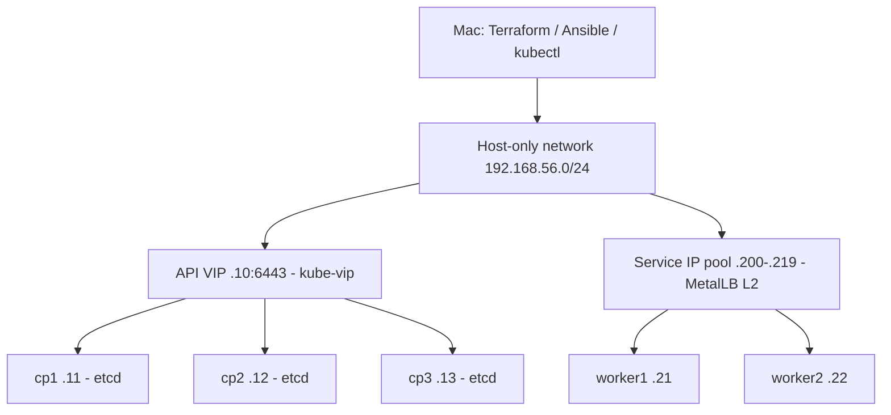

# Kubernetes HA lab on an Apple Silicon Mac

Planning baseline for Ubuntu Server 26.04 LTS ARM64, VirtualBox, Terraform,
Ansible and kubeadm: three control-plane nodes with stacked etcd and two workers.

**Status: design and configuration scaffold. VM creation, kubeadm installation,
and cluster deployment are not implemented or tested yet.** Terraform currently
calculates the topology and Ansible inventory; it does not provision VMs.

## Minimal resource budget

| Nodes | Count | vCPU each | RAM each | Dynamic root disk each |
| --- | ---: | ---: | ---: | ---: |
| cp1–cp3 | 3 | 2 | 2 GiB | 16 GiB |
| worker1–worker2 | 2 | 1 | 2 GiB | 20 GiB |
| Total | 5 | 8 allocated | 10 GiB | 88 GiB virtual capacity |

This is a constrained learning profile for a 16 GB host, with approximately
6 GB left before hypervisor overhead. vCPUs share the host CPUs; they are not
reserved physical cores. Close memory-heavy applications and stop Docker Desktop
and other VM workloads before running all five nodes. Watch macOS Memory Pressure;
stop the lab if pressure stays yellow/red or host swap keeps increasing. Workers
have little spare workload capacity; run small demonstrations with requests and limits.
For 32 GB hosts, prefer 3 GiB per control plane and 4 GiB per worker.

Use Server ARM64, without a desktop. Do not use AMD64 images or Raspberry Pi images.
Ubuntu currently provides a 26.04.1 ARM64 server installer in the 26.04 LTS series.
VirtualBox on ARM requires ARM guests. Its built-in unattended installer is
unavailable on ARM: use Ubuntu autoinstall with a tested seed, or prepare one
clean base VM and full-clone it after generalizing machine identity.

## Recommended topology



All nodes also have a NAT NIC for downloads. Host-only NICs carry node traffic,
SSH, the API VIP and service IPs. Use static node addresses and bind kubelet,
API advertise addresses and the CNI explicitly to this NIC; the NAT interfaces
can all have the same guest address. NAT remains the default route; the host-only
NIC must not install a competing default route.

On recent macOS, use VirtualBox **Host-Only Network** (`hostonlynet`), not legacy
`hostonlyif`/`vboxnet0` instructions. Proposed network: host .1, dynamic address
range .2–.9, static node/VIP addresses above it. Verify actual DHCP and host
addresses before use. Check LAN, WireGuard, Docker and other routes for conflicts;
these addresses are a proposal, not a discovered free network.

Pod CIDR: `10.244.0.0/16`; service CIDR: `10.96.0.0/12`. Both also require
route-conflict checks. Start with Flannel VXLAN and kube-proxy to keep the lab
small. Flannel does not enforce NetworkPolicy; use a tested Calico installation
when learning policy enforcement. Cilium is a later networking exercise.

### Two different load-balancing functions

- **kube-vip, ARP mode, control plane only:** static pods on the three control
  planes advertise `.10`. Configure kubeadm `controlPlaneEndpoint` to
  `192.168.56.10:6443`, including the VIP in certificate SANs. Follow the
  selected kube-vip release's kubeadm bootstrap procedure, including the
  initial kubeconfig handling. Install before joining cp2/cp3.
- **MetalLB L2:** assigns and advertises application Service `LoadBalancer`
  addresses `.200–.219`. Use worker speakers for the learning exercise. No
  router BGP or dedicated VM is needed. A single node receives traffic for
  each service VIP, with forwarding to service endpoints by kube-proxy.

kube-vip can also handle application Services and is the fewest-component option.
MetalLB is recommended here because it is explicitly part of the learning goal.
Never enable both controllers for the same Service pool. HAProxy on one extra
512 MiB VM is an alternative API endpoint but introduces a single point of
failure; two HAProxy/Keepalived VMs cost more RAM. Prefer kube-vip on this host.

Host-only service addresses are reachable from this Mac and attached VMs,
not automatically from the home LAN. Do not bridge onto Wi-Fi initially; add
LAN access only as a separate, tested networking exercise.

Three stacked etcd members tolerate loss of one control-plane VM. Losing two
loses quorum. All VMs share one Mac, SSD and power source, so this teaches node
failover, not physical infrastructure HA.

## Storage arrangement

Keep source code in a Git checkout and runtime disks outside that checkout:

```text
my-github-repos/k8s-virtualbox-homelab/  # source only
~/VirtualBox VMs/k8s-ha/
  images/                             # verified ARM64 installer / base image
  machines/                           # .vbox and dynamic .vdi files
  backups/                            # temporary local lab backups; private
```

The baseline can expose 88 GiB of virtual disk capacity, but dynamically allocated
VDIs consume space as written. Budget an estimated 40–55 GiB of actual VM data
for a small lab, another 5–10 GiB for installer/base image and temporary files,
and keep at least 30 GiB free for macOS. These are planning estimates, not
guaranteed bounds. Guest file deletion does not necessarily shrink host VDIs.

**Start the full build only with at least 100 GiB free; 120 GiB is preferred.**
The initial Mac assessment found about 76 GiB free, so first reclaim roughly
25–45 GiB or place the VM runtime on an external SSD. Nothing should be deleted
automatically. Inspect candidates with `du`, review them, and use each tool's
normal cleanup process. An external SSD helps disk capacity but does not add RAM.
Use APFS for a dedicated Mac SSD; do not reformat a drive containing data.

Use full clones for predictable independent node disks, not chains of linked
clones and snapshots. Keep at most one short-lived snapshot for an exercise.
Do not preallocate all disks or run large image registries, Ceph, Longhorn,
Elasticsearch, or a full monitoring stack in this minimum profile.

Phase one uses `emptyDir` demonstrations. Add a pinned local-path provisioner
later for small PVC exercises: use a worker directory on its root disk, with
node affinity. PVC data does not survive loss of that VM/disk and a PVC request
does not guarantee enforcement of a filesystem quota. Add a separate worker
data VDI only when needed and update the storage budget. NFS/RWX and replicated
storage belong in later exercises with more capacity.

Protect etcd with scheduled snapshots, copy needed backups off the Mac, and
practice restore in a disposable environment. Snapshots of VMs are not a
substitute for etcd and application backups. Keep kubeconfigs, keys and etcd
snapshots private and out of Git.

## IaC responsibilities

| Layer | Responsibility |
| --- | --- |
| Terraform | Typed topology, sizing, addresses and generated inventory now; VM lifecycle after provider proof |
| VirtualBox integration | Prove ARM64 VM creation, modern host-only NICs, full clone, disks, start/stop, refresh and destroy |
| Ubuntu image/seed | SSH public key, unique identity, network and Python bootstrap |
| Ansible | OS/containerd, pinned Kubernetes packages, VIP, sequential kubeadm bootstrap/join, CNI and add-ons |
| GitHub Actions | Static validation only; no access to the local Mac required |

Do not assume an old VirtualBox Terraform provider supports Apple Silicon and
modern host-only networks. Evaluate `terra-farm/virtualbox` or a maintained fork
in a disposable one-VM proof before selecting and pinning it. Require a
darwin_arm64 binary, ARM platform support, `hostonlynet`, predictable refresh,
and targeted deletion. The provider has not been validated for this host.
If unsuitable, explicitly choose either a small maintained custom provider or
a documented VBoxManage lifecycle adapter. A `terraform_data` plus scripts
adapter is a fallback with weaker drift/import semantics, not native provider
support. Do not silently substitute a different hypervisor.

For this single-user offline lab, local Terraform state is acceptable with a
private backup, a single writer and exclusion from Git. A shared backend is
only needed if collaboration warrants it. Commit dependency lock files after
providers are selected and initialized. Pin exact tested Kubernetes, containerd,
CNI, kube-vip and MetalLB versions; record image digests and Ubuntu SHA256 before
the implementation phase. No compatibility matrix has been tested yet.

## Safe commands available now

```sh
python3 scripts/preflight.py
terraform -chdir=terraform init -backend=false
terraform -chdir=terraform fmt -check
terraform -chdir=terraform validate
terraform -chdir=terraform plan
# Apply here only computes outputs/state; it creates no VMs.
terraform -chdir=terraform apply
mkdir -p .generated
terraform -chdir=terraform output -json ansible_inventory > .generated/inventory.json
ANSIBLE_LOCAL_TEMP=/tmp/k8s-lab-ansible ansible-inventory -i .generated/inventory.json --list
```

`ansible/preflight.yml` is a read-only guest check for the later SSH-ready VMs.
Do not run it before the VMs exist. `manifests/metallb-pool.example.yaml` is an
example requiring a working CNI, Ready workers, and MetalLB CRDs/controller.

## Implementation sequence and acceptance gates

1. **Host gate:** free at least 100 GiB, reduce competing memory use, confirm
   VBoxManage responds, check host OS compatibility. The inspected macOS version
   was 27.0.1; Oracle's retrieved 7.2 host list names macOS 26 and earlier, so
   support for this exact host version remains unverified. Do not upgrade or
   downgrade the host as part of lab setup without a separate decision.
2. **One-VM proof:** Ubuntu 26.04 ARM64 boots headless with 2 GiB RAM and SSH;
   NAT egress and Mac↔host-only reachability work. Test MAC address/ARP behavior
   for the future VIPs. Verify the Terraform provider lifecycle or choose the
   documented fallback. Delete only the disposable proof resources.
3. **Reproducible image:** pin installer checksum, automate Ubuntu autoinstall
   or generalize a base VM (machine-id, cloud-init state, host keys); generate
   unique MACs and identities on clones. Verify SSH host keys; never disable
   host-key checking globally. Keep private keys outside the repository.
4. **Five VMs:** create sequentially and validate addresses, DNS, clock sync,
   Python and memory. Terraform outputs drive Ansible inventory. Ansible uses
   `serial: 1` for control-plane changes and low concurrency for installation.
5. **OS and runtime:** disable swap persistently for the conventional kubeadm
   configuration, configure forwarding/modules and containerd CRI with systemd
   cgroups. Pin matching kubeadm/kubelet/kubectl packages from the appropriate
   `pkgs.k8s.io` minor repository; use holds to prevent unintended upgrades.
   Verify runtime/kernel compatibility on Ubuntu 26.04 before scaling out.
6. **Bootstrap:** kube-vip plus cp1, join cp2/cp3 with stacked etcd, deploy CNI,
   join workers and wait for all five Ready. Join tokens/certificate keys must
   be short lived, protected with Ansible `no_log`, and never stored in Git.
   Pin node IPs and route CNI traffic over the host-only NIC.
7. **Applications:** install MetalLB, wait for CRDs/webhook readiness, configure
   pool and worker labels, then expose a two-replica tiny HTTP app. Verify curl
   from the Mac to its assigned IP. Use `externalTrafficPolicy: Cluster` first.
8. **Recovery exercises:** stop one control plane; check API VIP and etcd quorum.
   Restore it before any second failure. Stop a service speaker and verify
   HTTP recovery. Drain a worker and verify stateless rescheduling; demonstrate
   the limitations of local PVCs. Measure rather than promise failover times.
9. **Repeatability:** a second Ansible run makes no unintended changes. A second
   Terraform plan is empty for actual VM resources once implemented. Rebuild
   the disposable cluster, test etcd restore and document stop/destroy procedures.

Baseline firewall rules must cover SSH from the host, API TCP 6443,
control-plane etcd TCP 2379–2380, kubelet TCP 10250, Flannel UDP 8472,
MetalLB memberlist TCP/UDP 7946, DNS and required outbound repositories.
Restrict etcd to control planes and all lab traffic to the host-only network.
Review the chosen versions' complete port requirements before applying rules.

## Sources

- [Oracle host/ARM limitations](https://docs.oracle.com/en/virtualization/virtualbox/7.2/user/installation.html)
- [Oracle host-only networking](https://docs.oracle.com/en/virtualization/virtualbox/7.2/user/networkingdetails.html)
- [VBoxManage reference](https://docs.oracle.com/en/virtualization/virtualbox/7.2/user/vboxmanage.html)
- [Ubuntu 26.04 ARM64 images and checksums](https://cdimage.ubuntu.com/releases/26.04/release/)
- [kubeadm installation prerequisites](https://kubernetes.io/docs/setup/production-environment/tools/kubeadm/install-kubeadm/)
- [kubeadm HA setup](https://kubernetes.io/docs/setup/production-environment/tools/kubeadm/high-availability/)
- [kube-vip static pods](https://kube-vip.io/docs/installation/static/)
- [MetalLB L2 behavior](https://metallb.io/concepts/layer2/)
- [Community Terraform VirtualBox provider](https://github.com/terra-farm/terraform-provider-virtualbox)
