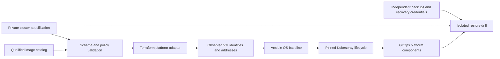

# Reusable on-premises Kubernetes foundation

A specification-driven foundation for Terraform VM provisioning, Ansible OS
security and Kubernetes lifecycle management, with recovery designed alongside
provisioning. Public files contain generic examples only.

**Status:** validated configuration foundation, not a qualified production
platform. The default Terraform root only calculates intent. A Proxmox adapter
is implemented for static/schema validation; it has not been applied to a
hypervisor. ARM64 lab template generalization and per-clone NoCloud seed tooling are
implemented; runtime evidence remains private. An OS baseline, Kubernetes/CNI
and a native VirtualBox Terraform adapter still require live qualification.

## Architecture



Terraform owns VM lifecycle; Ansible owns guest configuration; pinned Kubespray
owns Kubernetes, containerd, CNI and the API endpoint; GitOps owns additional
platform components. One controller owns each component. Hypervisor adapters
share a contract, not provider-specific resource implementations.

- [Architecture, ownership and adapter contract](docs/architecture.md)
- [Security, production acceptance and disaster recovery](docs/security-and-recovery.md)
- [Image qualification contract](images/README.md)
- [ARM64 lab template and clone workflow](images/virtualbox-arm64.md)
- [Default three-node VirtualBox lab](docs/lab-single-control-plane.md)
- [Ansible lab inventory and commands](ansible/inventory/lab/README.md)
- [Optional five-node HA learning lab](docs/lab-profile.md)

## Profiles and support

| Profile | Intent | Status |
| --- | --- | --- |
| VirtualBox / ARM64 (default) | One 2 GiB control plane, two 2 GiB workers; direct API, Calico | Three-node planning contract; VM adapter and runtime qualification required |
| VirtualBox / ARM64 (HA exercise) | Three 2 GiB control planes, two 2 GiB workers; kube-vip, MetalLB | Optional five-node planning contract; runtime qualification required |
| Proxmox VE / x86_64 | Independent control-plane placement, Calico, default systemd etcd colocated with control planes, GitOps, external CSI and independent backups | Native provider scaffold; no live qualification |
| Other hypervisors / operating systems | Same normalized VM observations and guest configuration boundary | Extension points; no implied support |

Kubespray's selected release labels its kubeadm-managed etcd mode experimental.
It is retained for the learning profile. The production example uses the default
host etcd mode. This is an explicit topology difference, not a claim that the
experimental mode is production-qualified.

## Customize and validate

Use Python 3.11–3.13 for the controller tooling. Install the hashed development
requirements in an isolated virtual environment:

```sh
python3 -m venv .venv
.venv/bin/python -m pip install --require-hashes -r requirements-dev.txt
.venv/bin/python scripts/specctl.py validate --spec specs/lab-virtualbox-single.json
.venv/bin/python scripts/specctl.py validate --spec specs/production-proxmox.example.json
.venv/bin/python scripts/specctl.py render --spec specs/lab-virtualbox-single.json --output .generated/lab-review
terraform -chdir=terraform init -backend=false
terraform -chdir=terraform plan
# After initialization, run the complete static check suite:
make check
```

Copy a generic specification into a private environment directory and customize
node classes, addresses, placement, image identity, security requirements,
components and recovery objectives. The JSON schema rejects unknown fields;
semantic checks reject overlapping networks, VIP collisions, mismatched images,
unsafe production topology and missing controls. A valid spec is not proof that
its routes, capacity or physical failure domains exist.

The renderer writes a clearly named `inventory.preview.json` until real VM
observations are supplied. With `--facts <terraform-output.json>`, it requires
matching VM IDs, guest-observed IPs, placement, image identity and deployment
qualification before producing `inventory.json`. Outputs use restrictive file
permissions and must remain ignored or outside the checkout.

`versions.lock.json` pins Kubespray by immutable commit, Kubernetes by patch and
the Proxmox provider by release. The Python runner dependencies are separately
locked with hashes. Image checksums, component chart versions/digests and runtime
qualification evidence must be recorded before deployment. Example images and
the release bundle intentionally remain `candidate`; deployment validation fails.

## Repository map

| Location | Responsibility |
| --- | --- |
| `specs/` | Versioned schema and generic cluster examples |
| `terraform/modules/cluster_contract/` | Shared typed VM intent and resource budget |
| `terraform/adapters/proxmox/` | Native VM resources, provider lock and backend example |
| `ansible/roles/os_baseline/` | Guarded SSH, time sync, auditing, journal limits and selected kernel protections |
| `ansible/preflight.yml` | Read-only checks against the declared guest contract |
| `scripts/specctl.py` | Validation and private input generation |
| `scripts/fetch-kubespray.sh` | Fetch and verify the pinned upstream source; no deployment |
| `tests/` | Specification and inventory safety checks |

Keep real site specifications, addresses, endpoints, inventories, state, plan
files, credentials, kubeconfigs, agent instructions and operational memory local
or in an appropriately controlled private repository. VM disks, image artifacts
and backups belong outside source control. Production state must use a tested,
locked, encrypted and independently recoverable backend outside the managed
Kubernetes cluster.

## Qualification sequence

1. Validate intent and establish network, storage, DNS, identity and failure domains.
2. Qualify a generalized image and one disposable VM on the selected adapter.
3. Prove the OS baseline preserves SSH, console recovery and CNI compatibility.
4. Deploy an isolated cluster using the pinned runner; prove idempotence and upgrades.
5. Qualify GitOps, policy, certificates, observability, CSI and backup integration.
6. Restore into an isolated environment and measure workload-specific RPO/RTO.
7. Promote the tested bundle only after the documented production acceptance gates pass.

A single physical host demonstrates node-failure exercises; it cannot satisfy
production host/site resilience. Production readiness is a measured release
outcome, not a profile name or a successful Terraform apply.
